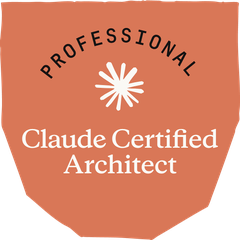

<h1 align="center">Simone La Porta</h1>
<p align="center">
  AI Solutions Architect · Cybersecurity Specialist<br>
  Claude Certified Architect · Azure AI Apps and Agents Developer · ISO/IEC 42001 Lead Auditor
</p>

<p align="center">
  
</p>

```bash
$ whoami
────────────────────────────────────────────────────────────────────────
 ROLE    AI Solutions Architect · Cybersecurity Specialist
 WORK    agentic AI development · multi-agent codebase review ·
         AI use-case risk assessment · trustworthy AI · cybersecurity
 GOAL    LLM and agentic systems, secure by design
 EDU     MSc Astrophysics & Cosmology · University of Bologna
 NOW     cloud agentic platforms: AWS Bedrock · Google ADK
────────────────────────────────────────────────────────────────────────
```

## About

My work has shifted from assessing AI systems to building them. I have
developed agentic AI solutions on internal GenAI platforms, delivered to
clients, and co-developed a multi-agent system that reviews agentic codebases
by combining static analysis with LLM-based evaluation of governance,
compliance and risk. I have also run the risk assessment of proposed AI use
cases, against a methodology and guardrail criteria I co-developed with my
team. Alongside that sit trustworthy-AI implementation (EU AI Act, ISO/IEC
42001, NIST AI RMF) and cybersecurity, from risk assessments and security
policies to access audits and awareness campaigns.

Astrophysicist by education (MSc, University of Bologna), I came to AI
through ML research on gravitational lensing, with a thesis on automatic
differentiation, later grown into a [PyTorch lensing toolkit](https://github.com/Shurtug4l/lensing).
I co-authored [HH4AI](https://ceur-ws.org/Vol-4074/paper6-18.pdf), a
methodological framework for AI Human Rights Impact Assessment under the EU
AI Act (*LSAI 2025*, Pisa). Off the keyboard, the mountains: ski
mountaineering, alpinism, trail running.

## Certifications

<a href="https://www.credly.com/badges/444a755e-6e13-4e7a-b70d-62f44032089b"></a>

- **Claude Certified Architect - Professional**, Anthropic, 2026 ([verify](https://www.credly.com/badges/444a755e-6e13-4e7a-b70d-62f44032089b))
- Claude Certified Developer - Foundations, Anthropic, 2026
- Claude Certified Associate - Foundations, Anthropic, 2026
- Azure AI Apps and Agents Developer Associate (AI-103), Microsoft, 2026 ([verify](https://learn.microsoft.com/en-us/users/simone0509/credentials/certification/azure-ai-apps-and-agents-developer-associate))
- AI Solutions Architecture, ProfessionAI, 2026 (professional master, 400 hours, 11 hands-on projects from RAG and agentic capstones to multi-cloud architecture and AI Act governance)
- ISO/IEC 42001 Lead Auditor
- Cybersecurity Specialist, EPICODE, 2024

## Featured work

### [`sec-recon-agent`](https://github.com/Shurtug4l/sec-recon-agent)

Type-safe LLM vulnerability triage on Pydantic AI and a custom MCP server.
Ten typed tools (NVD · OSV · CISA KEV · EPSS · Exploit-DB · MITRE ATT&CK ·
SBOM · Nmap) ground every answer in a validated `TriageReport` with a
deterministic SSVC verdict.

- **Threat-modeled.** MITRE ATLAS red-team battery, OWASP LLM Top 10 and
  ISO 42001 mapping, reproducible scorecard: red-team resistance 17/18, p95
  latency 70 s, $0.08 per triage on Sonnet.
- **CI gate.** The same tool chain ships on the GitHub Marketplace as a
  deterministic, LLM-free SBOM gate, with an SSVC verdict per finding, SARIF
  and OpenVEX output and a CI exit code as the contract.
- **Checkable.** Every headline claim points to file:line. The
  [live demo](https://shurtug4l.github.io/sec-recon-agent/) replays real
  captured triages and needs no API key; the
  [scorecard](https://shurtug4l.github.io/sec-recon-agent/scorecard) is public.

## Stack

```
agentic          LangGraph · LangChain · Pydantic AI · MCP · n8n
llm / rag        OpenAI / Azure / Anthropic APIs · Hugging Face Transformers
                 sentence-transformers · LiteLLM · ChromaDB · FAISS · BM25 hybrid · Ollama
engineering      Python · FastAPI · Flask · Docker · pytest · Git · GitHub Actions · Bash · SQL
ai-assisted dev  Claude Code (daily driver) · GitHub Copilot · agentic coding workflows
cloud / mlops    AWS SageMaker · Azure ML / OpenAI · Vertex AI (GCP)
ml / data        PyTorch · TensorFlow · scikit-learn · pandas · NumPy
ai security      OWASP LLM Top 10 · MITRE ATLAS · LLM red teaming · threat modeling
governance       EU AI Act · ISO/IEC 42001 · NIST AI RMF
vapt             Nmap · Metasploit · Burp Suite · SQLmap · Nessus · Wireshark · Splunk · Semgrep
```

---

<p align="center">
  Full CV, experience and education on <a href="https://linkedin.com/in/simonelaporta">LinkedIn</a>.
</p>
